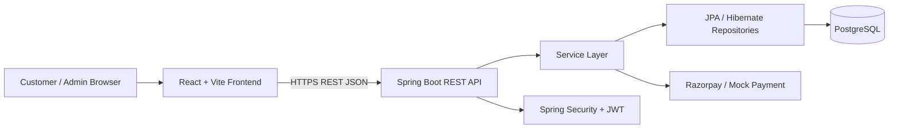

# InsureHub Architecture

## Three-tier flow



## Backend packages

```text
backend/src/main/java/com/insurehub/
├── controller/
├── service/
├── repository/
├── entity/
├── dto/
├── security/
├── exception/
└── config/
```

Controllers are intentionally thin. Business rules live in services, database access stays in repositories, entities model persistence, and DTOs define the API boundary.

## Policy renewal workflow

```text
POST /api/policies/{id}/renew
        ↓
PolicyController
        ↓
RenewalService
        ↓
validate owner + state
        ↓
calculate new premium
        ↓
update dates/status
        ↓
write PolicyHistory
        ↓
return PolicyResponse
```

## Cancellation workflow

```text
Customer → POST /policies/{id}/cancel
             ↓
        CANCEL_REQUESTED
             ↓
        PolicyHistory record
             ↓
Admin → approve / reject
             ↓
     CANCELLED or restore previous state
             ↓
        PolicyHistory record
```
